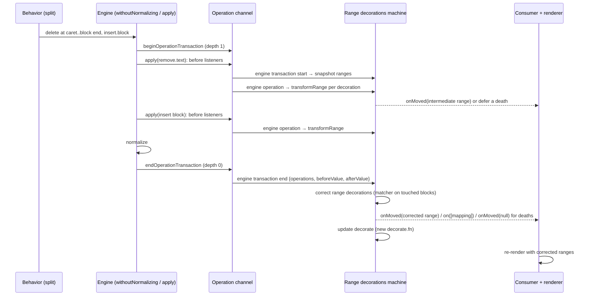

# Range decoration re-anchoring spike

Branch `spike/reanchor-range-decorations`, reviewed snapshot `dd5591b60` plus review fixes, base `origin/main` `cacd2c9b6`.

## 1. TL;DR

Range decorations (highlights, comment ranges) are stored as a selection and moved one operation at a time.
That works for typing, but Enter, Backspace-merge and paste are each several operations, and the first operation often removes the highlighted text before a later one puts it back somewhere else.
So on `main`, a highlight can shrink, die, or end up on the wrong text after a split or merge.
The spike keeps the per-operation moving, but adds one more step at the end of each engine transaction: it remembers each decoration before the transaction, compares the document before and after, and re-finds the decoration's text if per-operation moving lost it.
It also tightens when a decoration dies, and reports deaths to `onMoved` only once the transaction is over.

See section 8 for how this differs from the closed PRs #2413 and #3208.

## 2. The current system (`main`)

### How a decoration is stored

A decoration is a range: an `anchor` and a `focus` point.
A point is a keyed path to a span plus a character offset in that span:

```ts
{
  anchor: {path: [{_key: 'b1'}, 'children', {_key: 's1'}], offset: 0},
  focus: {path: [{_key: 'b1'}, 'children', {_key: 's1'}], offset: 11},
}
```

There are two ways to supply decorations. Both end up in the same machine.

- **Prop decorations**: `<PortableTextEditable rangeDecorations={...}>`. Each entry has a `selection`, a `component` and an optional `onMoved` callback. `Editable.tsx` sends them to the machine as a `source updated` event with `kind: 'prop'`. The consumer usually owns the array and stores whatever `onMoved` reports (a "controlled" decoration).
- **Registered decorations**: `editor.registerDecorations(...)` (`src/editor/range-decorations-registration.ts`). Each entry has an `id` and a `range`. The registration's `onMapped` callback receives a batch of `DecorationMapping`s (`previousRange`, `newRange`, `contentTouched`, `origin`). A dead `id` is remembered in `deadSelections` so a later `update()` doesn't bring it back.

### How decorations move today

`src/editor/range-decorations-machine.ts` is an xstate machine.
It holds one `RangeDecorationSource` per prop or registration.

1. The machine subscribes to the engine's **operation channel** (`subscribeToOperations` in `src/engine/core/operation-channel.ts`) in the `before` phase. The `before` phase runs while the old tree still exists, which the transform needs.
2. For every operation except `set.selection` it receives `engine operation`.
3. `move range decorations` runs `transformRange` (`src/engine/range/transform-range.ts`) on every decoration:
   - prop: `movePropDecoratedRanges` calls `onMoved` with the new range, or with `null` if the range is gone.
   - registered: `moveRegisteredDecoratedRanges` builds mappings. A range that becomes collapsed (zero length) or `null` dies.
4. The machine writes the flattened list to `editorEngine.decoratedRanges`.

`transformRange` moves each point through one operation (`transformPoint`).
An `operation` is a small edit like `insert.text`, `remove.text`, `insert` (insert a node) or `unset` (remove a node).
For `remove.text`, a point inside the removed text snaps to the removal's start.

### How decorations are rendered

The machine's context has `decorate.fn` (built by `createDecorate`).
`Editable.tsx` reads it with `useSelector` and passes it to the renderer.
For each text block, `decorate` returns the `decoratedRanges` that intersect it, and the leaf renderer wraps the text with each decoration's `component`.
On `main`, `decorate.fn` is only recreated when a source changes (`update decorate if source changed`).

### Why that breaks on split, merge and paste

The engine has no "move text to another block" operation.
Pressing Enter in the middle of a block is written as two operations (see `behavior.abstract.split.ts`):

1. `remove.text`: delete the text after the caret from the current block.
2. `insert`: insert a new block that contains that text.

Per-operation moving only sees step 1: "this text was deleted".
It can't know that step 2 re-creates the same text in a new block.
The text has lost its identity.

Tiny example. Block `b1` has one span `s1` with `"hello dolly"`, and a highlight covers all of it: `b1/s1:0 → b1/s1:11`. The caret is at offset 6 and you press Enter.

| Step | Document | Highlight on `main` |
|---|---|---|
| before | `b1: "hello dolly"` | `b1/s1:0 → b1/s1:11` |
| `remove.text` at 6, `"dolly"` | `b1: "hello "` | `b1/s1:0 → b1/s1:6` (the focus snapped back) |
| `insert` new block | `b1: "hello "`, new: `"dolly"` | unchanged, so `"dolly"` loses its highlight |

If the highlight covered only `"dolly"`, step 1 collapses it to zero width, and it dies.
Merge (Backspace at a block start) and paste have the same shape: text is removed in one place and re-inserted in another.

## 3. What the spike adds

### (a) A transaction-end hook in the engine

New in `src/engine/core/operation-channel.ts`:

- A **transaction** is one outermost synchronous engine call: one `apply`, or one `withoutNormalizing` block with everything nested inside it, including normalization fixes.
- `beginOperationTransaction` / `endOperationTransaction` keep a depth counter (`editor.operationTransactionDepth`). `apply` (`core/apply.ts`) and `withoutNormalizing` (`editor/without-normalizing.ts`) both bracket their work with them.
- While a transaction is open, `apply` records each operation's `OperationEvent` in `editor.operationTransactionEvents`.
- When the depth goes back to 0, every `transactionEnd` listener gets one `OperationTransactionEvent`: `{operations, beforeValue, afterValue, origin}`. `origin` is the first operation's origin.
- `subscribeToOperationTransactions(editor, listener)` subscribes.

Why it must be **synchronous**: it fires inside the same call stack as the edit, before control goes back to the caller.
So the next thing that reads decorations (`getDecorations()`, a behavior, the next render, a consumer's `update()`) already sees the corrected range.
An earlier version of the spike (`f85fac1f6`) waited for the asynchronous `onChange` flush. In between, readers saw stale ranges, and a consumer `update()` could shift a range twice.

### (b) A snapshot before, a correction pass after

In the machine:

1. **Snapshot.** The operation listener sends `engine transaction start` when it sees the first operation of a transaction (`operationTransactionEvents` is still empty). The action `capture transaction sources` copies every source's ranges into `context.transactionSources`.
2. **Per-operation moving stays.** `engine operation` still runs `transformRange` per operation, so typing behaves exactly as before. New option: `relocateUnset` (on for everything except undo and redo). When an `unset` removes the node a point sits in, `relocateUnsetPoint` tries one destination:
   - a block was removed and exactly one other block contains a child with the same `_key`, or
   - a span was removed and exactly one other span's text **ends with** the removed span's text.
3. **Correction.** `engine transaction end` runs `correct range decorations`:
   - `getStructuralTouchedBlockKeys` decides if the transaction was structural: a top-level block `insert`/`unset`, or (with no top-level change) a block that had both `remove.text` and a child `insert`/`unset`, which is how a same-block paste looks. If nothing was structural, it skips straight to the death checks.
   - Otherwise `createRangeReanchor(beforeValue, afterValue, schema, blocks)` builds the **matcher** (`src/internal-utils/reanchor-range-decorations.ts`). It only compares the touched blocks plus their neighbours (`getTouchedBlockKeysWithNeighbors`).
   - The matcher works on plain text. `matchBlocks` labels each old block `matched`, `split`, `merged`, `removed` or `added`, by comparing block keys and text (for example: "the old block got shorter and the new block right after it is exactly the missing tail" means `split`). Inside a block, a text diff (`@sanity/diff-match-patch`) shifts offsets. `shiftPoint` maps a point through that, and `recoverRemovedEndpoint` tries to rescue an endpoint whose block is gone. The matcher is a port of the labs `packages/reanchoring` algorithm, and has since diverged from it.
   - `correctSourceRanges` takes each snapshotted range in a touched block, re-anchors it, and replaces the live range when the matcher moved an endpoint to a different block (or, for the same-block paste case, whenever the matcher has a result). It then calls `onMoved` (prop) or `on` with one mapping (registered).

### (c) When a decoration dies, and keeps its direction

- **Collapsed means dead.** If an operation turns a non-collapsed range into a collapsed one, it dies. This is new for prop decorations; `main` kept them as a collapsed range.
- **Zero width means dead.** If the endpoints sit on two different spans but at the same block offset (no text in between), `movePropDecoratedRanges` treats it as dead. Otherwise later inserts could push the endpoints apart in reverse order.
- **Prop deaths wait for the transaction end.** A prop death goes into `deadPropSelections`. If correction revives the range, the death is cancelled. Otherwise `notifyDeadPropSelections` calls `onMoved({newSelection: null})` at transaction end. Registered deaths are still reported per operation, so a revived registered decoration gets `null` and then its new range.
- **Revival only onto identical text.** Every decoration that collapsed in this transaction is put in `collapsedInTransaction`. Correction may only bring it back if `coversSameText` holds: the text under the new range equals the text under the old range. A range that was collapsed before never becomes non-collapsed.
- **Fully deleted stays dead.** `recoverRemovedEndpoint` skips blocks where none of the range's text survived, so a fully replaced range gets `null` instead of landing on neighbouring text. `killCollapsedPropRanges` makes a final sweep for prop ranges that end the transaction collapsed or zero width.
- **Direction.** The matcher maps `anchor` and `focus` separately, each with its own insert affinity, so a backward range stays backward. A collapsed input point is mapped once and used for both ends, so it can't open up into a range.

Also fixed along the way: a prop decoration with `selection: null` no longer calls `onMoved(null)` on every update (on `main` this can loop a controlled consumer).

### (d) Prop decorations matched by stable identity

Consumers replace prop objects all the time (`{...decoration, selection: newSelection}`), so object identity and array index both fail as a lookup key.
Each `DecoratedRange` now carries an internal `propIdentity`. It is the first object seen, and is carried over when `onMoved` produces a new object.
Correction finds "the same decoration" with `findCurrentDecorationIndex` by `propIdentity` (prop) or `id` (registered).
Across a prop **update** from the consumer, the identity is still copied by array index (`buildPropDecoratedRangesFromScratch`). See section 6.

## 4. How it's hooked in

### File map

| File | Role |
|---|---|
| `src/engine/core/operation-channel.ts` | New transaction API: `beginOperationTransaction`, `endOperationTransaction`, `recordOperationTransactionEvent`, `subscribeToOperationTransactions`, and the `OperationTransactionEvent` type. |
| `src/engine/core/apply.ts` | Wraps the whole body in begin/`try`/`finally` end. Builds and records an `OperationEvent` when any transaction listener exists. The rest is re-indentation. |
| `src/engine/editor/without-normalizing.ts` | Wraps `fn` and the trailing `normalize` in one transaction. `normalize` moved into the `finally` (see blocker 3). |
| `src/engine/interfaces/editor.ts`, `src/engine/create-editor.ts` | New editor fields: `operationListeners.transactionEnd`, `operationTransactionDepth`, `operationTransactionEvents`. |
| `src/engine/interfaces/range.ts` | Adds `relocateUnset?` to `RangeTransformOptions`. |
| `src/engine/range/transform-range.ts` | `relocateUnsetPoint`: moves a point across an `unset` to its only possible destination. |
| `src/internal-utils/reanchor-range-decorations.ts` | The matcher: `createRangeReanchor`, `matchBlocks`, `shiftPoint`, `recoverRemovedEndpoint`, plus `getRangeDirection` and `getRangeText`. Pure functions. |
| `src/editor/range-decorations-machine.ts` | New events `engine transaction start`/`end`, the snapshot, `correct range decorations`, the death rules, `propIdentity`. `update decorate` now runs after every transaction. |
| `src/editor/range-decorations-machine.test.ts` | The engine stub gets the new fields. |
| `src/engine/range/transform-range.test.ts` | Unit tests for `relocateUnset`. |
| `src/internal-utils/reanchor-range-decorations.test.ts` | Unit tests for the matcher. |
| `tests/range-decorations.test.tsx` | Browser regressions found in the playground (repeated splits, replace after split, null selection, registered updates, duplicate-key rekey). |
| `tests/spike-split-merge-decorations.test.tsx` | Shared acceptance scenarios: split, merge, line break, overlap, undo/redo, paste (P1–P3), cross-block replace and delete (X1–X4). |
| `.changeset/reanchor-range-decorations.md` | A patch changeset. Its first line still reads "spike: ...". |

### One Enter, end to end



A plain keystroke follows the same path. It has a single operation, `getStructuralTouchedBlockKeys` finds nothing structural, and only the death checks run.

## 5. Walkthrough: Enter inside a highlight

Same document as before. This is acceptance scenario 1.2 in `tests/spike-split-merge-decorations.test.tsx`.
`bN` and `sN` below stand for the generated keys of the new block and its span.

**Before:** `b1: "hello dolly"`, highlight `b1/s1:0 → b1/s1:11`, caret at `b1/s1:6`.

1. **Transaction opens.** The split behavior raises `delete` and `insert.block`, and `performEvent` runs them inside one `withoutNormalizing` (`withoutNormalizingConditional` in `behavior.perform-event.ts`), so the depth goes to 1.
2. **`remove.text` (offset 6, `"dolly"`).** The machine sees `engine transaction start` first and snapshots `b1/s1:0 → b1/s1:11`. Then `transformRange` moves the focus back to 6. The range `0 → 6` is still non-collapsed, so it stays alive. A prop decoration gets `onMoved(b1/s1:0 → b1/s1:6)`, and a registered one gets a mapping to the same range. Both are intermediate values.
3. **`insert` block `bN` with `"dolly"`.** The new block comes after `b1`, so the range doesn't change.
4. **Transaction ends.** `getStructuralTouchedBlockKeys` sees a top-level `insert`, so the touched keys are `{b1, bN}`.
5. **Matcher.** `matchBlocks` sees that `b1` went from `"hello dolly"` to `"hello "` and that the new next block `bN` is exactly `"dolly"`. That is a `split` at offset 6. `shiftPoint` leaves the anchor (offset 0 < 6) in `b1`, and moves the focus (offset 11 ≥ 6) to `bN` offset 11 − 6 = 5.
6. **Correction.** The re-anchored focus is in a different block than before, so `correctSourceRanges` replaces the live range and calls `onMoved(b1/s1:0 → bN/sN:5)`. A registered decoration gets one more `on([...])` mapping with the corrected range, after the per-operation mapping it already got in step 2.
7. **Render.** `update decorate` creates a new `decorate.fn`, and both blocks render highlighted.

**After:** `b1: "hello "`, `bN: "dolly"`, highlight `b1/s1:0 → bN/sN:5` covering `"hello dolly"`.

If the highlight had covered only `"dolly"` (`6 → 11`), step 2 would collapse it to `6 → 6`. That is a provisional death: it goes to `deadPropSelections` and `collapsedInTransaction`. In step 6, the matcher maps it to `bN/sN:0 → 5`, `coversSameText` sees `"dolly"` both before and after, so the death is cancelled and no `null` is sent.

## 6. Known limitations and open items

Argus reviewed `dd5591b60`. The commits after the README commit fix his three blockers and two of his should-fix items. Section 4 still describes the shape at `dd5591b60`. The fixes below change details inside it, not its overall structure.

### Fixed after the review

1. **Revival onto identical text** (`7d9c13056`). A collapse now records the `remove.text` that caused it. Correction only revives the decoration if an insert in the same transaction carries the removed text in a span with the removed span's key, which is how a split writes its tail into the new block. Undo and redo accept any span key, because they replay an earlier move. `coversSameText` and the `endsWith` branch of `relocateUnsetPoint` are gone. Case: `b0: "foo"`, `b1: "foo"`, decoration on `b1`. Select from the end of `b0` to the end of `b1` and press Backspace or Delete: the decoration now dies, as on `main`. Tested for prop and registered decorations.
2. **Performance** (`22af18320`, `d9dc4d54b`). The zero-width check works from paths alone. The transaction snapshot keeps range arrays by reference. Before-ranges are looked up by identity in a Map. A transaction of only `insert.text` and `set.selection` skips correction. Transaction end never recreates `decorate.fn`. 1000 blocks × 1000 decorations, measured in the same container: 50 keystrokes take 218–231 ms against `main`'s 202–218 ms, and 20 Enters 261–329 ms against 246–271 ms. That is 1.0–1.2× `main`, down from about 7×.
3. **Masked errors** (`45509a34e`). `withoutNormalizing` follows `main`'s order again, so a throwing `fn` is not normalized and keeps its error. Transaction-end listeners are each wrapped in try/catch. Covered by unit tests in `operation-channel.test.ts`.
4. **One `onMoved` per transaction** (`6f7f8158b`). The live range still updates per operation, for rendering and `getDecorations()`. Consumers get deaths, then one `onMoved` per decoration whose final range differs from its starting range.
5. **Tests assert outcomes** (`8d3aebc86`). The acceptance tests check the final callback and the rendered text instead of full `onMoved` sequences.

### Still open

- Registered decorations still get one `on(mappings)` batch per operation, so they can report a short-lived `null` before correction revives them. Batching them per transaction changes the `onMapped` contract.
- Prop identity is still copied by array index across consumer updates (Argus #5).
- The survival gates in `correctSourceRanges` should become a short rule table (#6). `spike-split-merge-decorations.test.tsx` should be merged into `range-decorations.test.tsx`.
- The changeset still says "spike:" and doesn't describe the behaviour changes (#8).
- The matcher has diverged from labs. Either make it the canonical copy or document the difference (#9).
- Undo and redo revival is still a text check, though limited to history replays. A precise version would link the undo step to the original split or merge.
- Nits: the transaction origin is the first operation's origin, `apply`'s inner body should be extracted, and `relocateUnset?` should be required. Custom behaviors that mix `execute` and `effect` across transactions are untested.

### Suggested PR split (Argus)

1. `fix:` a controlled prop decoration with `selection: null` loops on `onMoved`. It's small, independent, and a real bug on `main`.
2. Engine: the internal transaction-end channel (`operation-channel`, the `apply`/`withoutNormalizing` brackets), with unit tests and no behaviour change. This is the piece maintainers must agree to.
3. Range decorations follow split/merge/paste: the correction pass, matcher, operation-based survival, one `onMoved` per transaction, the performance fixes, a benchmark, and a changeset that describes the behaviour changes.

## 7. How to try it

From `packages/editor`, after `pnpm install` and building the package's dependencies (see `AGENTS.md`), run one file at a time:

```sh
# Unit tests: the matcher and transformRange
npx vitest --run --project unit src/internal-utils/reanchor-range-decorations.test.ts
npx vitest --run --project unit src/engine/range/transform-range.test.ts

# Browser tests (Chromium)
npx vitest --run --project "browser (chromium)" --maxWorkers=1 src/editor/range-decorations-machine.test.ts
npx vitest --run --project "browser (chromium)" --maxWorkers=1 tests/spike-split-merge-decorations.test.tsx
npx vitest --run --project "browser (chromium)" --maxWorkers=1 tests/range-decorations.test.tsx
```

To try it by hand, use the playground: a preview build of this branch (plain editor plus `rangeDecorations`, current ranges and an `onMoved` log under it). It is hosted privately in the Horizon "Split/merge highlight preview" mod (entry "re-anchoring v3"), not publicly. Highlight some text, then press Enter, Backspace across a block break, or paste inside the highlight.

## 8. How this differs from the closed attempts

### #2413 `fix/range-decoration-split-merge` (closed unmerged 2026-04-01)

[#2413](https://github.com/portabletext/editor/pull/2413) ("fix: pre-transform range decorations during split and merge", head `025c01cb5`) addressed the same bug in two places:

- **Inside `applySplitNode` and `applyMergeNode`**, it pre-transformed `editor.decoratedRanges` before the decomposed operations ran, the same way those functions already handle refs and the selection. It used inward affinity for splits.
- **In the range-decorations machine**, when a `remove_text` collapsed a decoration that sat entirely inside the removed text, it stored the decoration as "displaced", with offsets relative to that text. A later `insert_node` whose block *contained the same text* re-attached it. Displaced decorations that were never re-attached were reported as removed.

What this branch does differently:

| | #2413 | This branch |
|---|---|---|
| Where it hooks in | Two specific paths: the split/merge apply functions and the machine's `remove_text` → `insert_node` sequence | One transaction-end pass over every operation, so it doesn't matter which behavior or code path made the edit |
| Deciding a decoration survives | Text match: any inserted block that contains the removed text | Operation provenance: the same transaction must re-insert the removed text under the removed span's key (any key for undo/redo). Identical text elsewhere doesn't count, which is Argus's blocker 1 and also the hole in #2413's text match |
| Paste, custom behaviors, undo/redo, remote edits | Only what flows through those two paths | Covered by the same pass |
| Partly covered decorations | Only re-attached decorations fully inside the removed text | Re-anchors ends that land on moved text through the matcher, including partial overlaps |
| `onMoved` | Per operation, including intermediate states | Once per decoration per transaction, with the final range |
| Engine changes | None beyond the two apply functions | An internal transaction-end channel (`operation-channel`, `apply`/`withoutNormalizing` brackets). No public API |

### #3208 `feat/steps-package` and #3154 (closed unmerged 2026-09-08)

[#3208](https://github.com/portabletext/editor/pull/3208) didn't fix decorations directly. It proposed a shared `@portabletext/steps` package: an interpreter from Sanity patches to eight semantic steps (including `move.text` and `move.node`), plus `mapPoint` and inward-affinity `mapRange`. The idea was one position-mapping implementation shared by the caret, comment anchors and server-side re-anchoring. It came out of [#3154](https://github.com/portabletext/editor/pull/3154), which fixed remote caret recovery only.

This branch is local and narrower: it works on the editor's own operations during a local transaction, not on wire patches, and it needs no new package. An earlier spike that wired #3208's steps into the editor passed 9 of 23 shared split/merge/undo tests, against 23 of 23 for this approach. If maintainers want the steps layer, this pass could later take its moves as input in place of the matcher.
