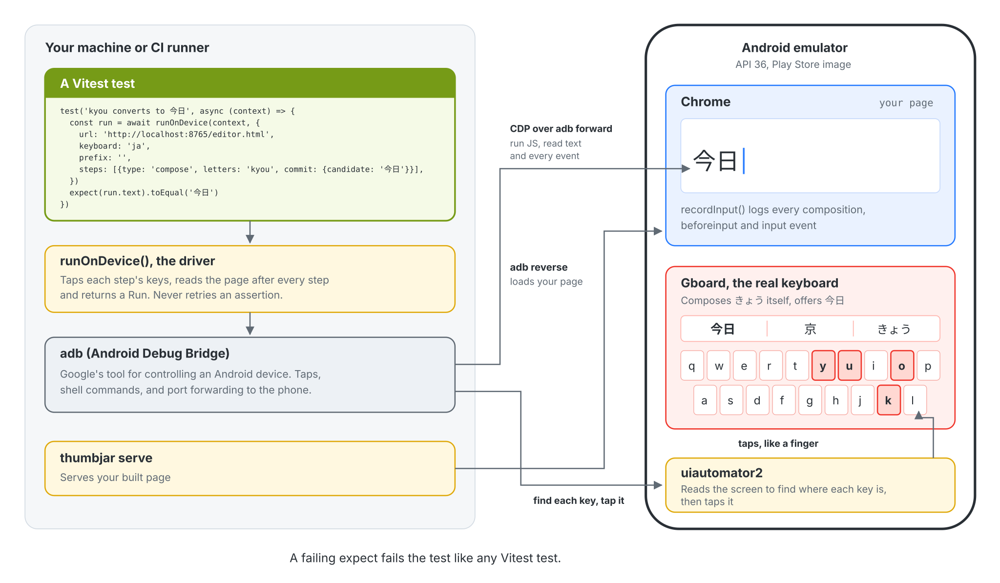

# thumbjar

Test web text fields and editors against a real Android keyboard.

Editors and text fields break on Android in ways desktop tests never show. Gboard composes words, offers conversion candidates, and reacts when the page changes the DOM in the middle of a composition. Synthetic events from Playwright or jsdom don't behave like that, so those bugs only show up with a real Android keyboard. thumbjar taps real Gboard keys on an Android emulator while your page is open in Chrome, then hands what the page recorded back to your Vitest test.

## At a glance

In the page under test, which you build and serve:

```ts
import {recordInput} from 'thumbjar/page'

recordInput({getText: () => document.querySelector('textarea')!.value})
```

In a Vitest test:

```ts
import {runOnDevice} from 'thumbjar'
import {expect, test} from 'vitest'

test('kyou converts to 今日', async (context) => {
  const run = await runOnDevice(context, {
    url: 'http://localhost:8765/editor.html',
    keyboard: 'ja',
    prefix: '',
    steps: [{type: 'compose', letters: 'kyou', commit: {candidate: '今日'}}],
  })

  expect(run.text).toEqual('今日')
})
```

## How it works



1. `thumbjar serve` serves your built page, and the driver runs `adb reverse` so Chrome on the emulator reaches it at the same `localhost` URL.
2. `recordInput()` in the page records the field's text, selection and input events.
3. For each step, the driver reads Gboard's keys from the screen's accessibility tree and has the uiautomator2 server on the device tap them.
4. After each step, the driver reads what the page recorded over the Chrome DevTools protocol. When the last step is done, `runOnDevice` returns all of it to your test as one `Run`.

## Install

```sh
npm install --save-dev thumbjar vitest
```

Use Node 24 or later. Install the Android SDK with `adb` and `emulator` on your `PATH`. Create an API 36 Play Store emulator with Chrome and Gboard installed. The keyboard options are currently `ja` for Japanese QWERTY and `en` for English.

## Host notes

thumbjar runs on Linux and macOS without GNU coreutils. For Linux x86_64, use an x86_64 emulator image. For macOS on Apple Silicon, use an ARM64 image and start the emulator with `-gpu swiftshader_indirect`. Gboard's language download on macOS may need a proxy for QUIC. These are emulator and host setup notes.

For CI, provision the SDK, image, Chrome and Gboard on your runner. Boot the emulator yourself and keep the built test page served while tests run. thumbjar prepares a booted device. It does not boot one.

## First run

Download the pinned uiautomator2 server jar before booting the emulator. Run this command from the package you run Vitest in, so the tests find the cached jar:

```sh
npx thumbjar fetch-u2-jar
```

The download checks the jar's hash and reuses a matching cached file. The default path is `node_modules/.cache/thumbjar/u2.jar` in the nearest directory with a `package.json`, starting from the working directory. Set `CACHE_DIR` to a directory to use `$CACHE_DIR/thumbjar/u2.jar` instead. It needs a writable cache directory in that package. The command tries three downloads of up to 45 seconds each, with 15 seconds between retries.

Next, boot your emulator. Build your test page and serve its output directory in another terminal:

```sh
npx thumbjar serve dist --port 8765
```

Prepare the device, then run the tests:

```sh
npx thumbjar prepare --keyboard ja --page-url http://localhost:8765/editor.html
npx vitest run --project device
```

`serve` defaults to port `8765`. `prepare` requires `--keyboard ja|en` and `--page-url`. Its `--out-dir` defaults to `out`. Optional `--booted` supplies the host's epoch seconds when the emulator came online. Without it, the dictionary wait uses the time preparation started.

Preparation attempts to disable Play Store updates, waits out post-boot system error dialogs, sets up Chrome and the soft keyboard, and checks the page URL. For Japanese, it adds the QWERTY layout and waits for this boot's dictionary-load log. Then it switches Gboard to Japanese, first switching away if Japanese is already showing. It checks conversion candidates by typing `kyou` into the page. A dictionary wait allows up to 360 seconds from `--booted`.

A Japanese dictionary that never loads exits with status `3`. Other preparation failures exit with status `1`. A missing or invalid flag value exits with status `2`. If preparation receives `SIGINT`, `SIGHUP` or `SIGTERM`, it exits with status `130`, `129` or `143`, respectively.

The driver forwards a host `localhost` page port to the device with `adb reverse`. It adds or replaces the URL's `prefix` search parameter. Read that parameter in your page to put the prefix in its field.

## Set up the page

Call `recordInput({getText, getState?, actions?, field?})` from `thumbjar/page` once in the page the driver opens:

```ts
import {recordInput} from 'thumbjar/page'

const field = document.querySelector('textarea')!
field.value = new URL(location.href).searchParams.get('prefix') ?? ''

recordInput({
  field,
  getText: () => field.value,
  getState: () => ({length: field.value.length}),
  actions: {
    clear: () => {
      field.value = ''
    },
  },
})
```

`getText` returns a string or `null`, such as text read from your editor model. Optional `getState` returns additional state. Keep it JSON-serializable so it can cross the Chrome DevTools connection. Exceptions from these callbacks reach the driver.

`field` identifies the element to type into and record on. Without it, thumbjar records events on `document` in the capture phase and finds the first `textarea`, text `input` or `[contenteditable]`. Text input types include `text`, `search`, `tel`, `url` and `password`, plus inputs with no type or an empty type. The exported `TEXT_FIELD_SELECTOR` contains this selector. A field may render after `recordInput` runs when no explicit field is supplied.

`recordInput` installs `window.__state`, `window.__field`, `window.__selection` and `window.__action` for the driver. The state contains `text` and `events`, plus `state` when `getState` is supplied. Without an explicit field it also contains `dom`, the discovered field's text. Field text comes from `value` for inputs and textareas, or `textContent` otherwise.

The recorder captures `beforeinput`, `input`, `compositionstart`, `compositionupdate` and `compositionend`. Event records contain `type`, `inputType`, `data`, `text` and `selection`. Selection offsets are direction-aware `{anchor, focus}` in UTF-16 units, or `null` outside the field. `beforeinput` and `input` also capture `isComposing` and `cancelable`. When supported, `targetRanges` contains `{start, end}` UTF-16 offsets, `null` for a range outside the field, or `[]` for no ranges. Failed reads record `null`.

`defaultPrevented` is read after dispatch by a zero-delay timer. An absent value means unknown, never `false`. A `#log` element, if present, displays the event records and updates after the timer.

## Configure Vitest

```ts
import {deviceProject} from 'thumbjar/vitest'
import {defineConfig} from 'vitest/config'

export default defineConfig({
  test: {
    projects: [
      deviceProject({
        include: ['tests/*.test.ts'],
        pageUrl: 'http://localhost:8765/editor.html',
        pageHint: 'Build and serve the test page first.',
      }),
    ],
  },
})
```

`deviceProject` uses the Node environment, runs one file at a time, sets `retry: 0` and supplies timeouts from the driver's budget. Its name defaults to `device`. `outDir` defaults to `out`. `setupFiles` adds your setup files after thumbjar's. Optional `summaryFile` receives outcome counts and a per-test table after each file.

Global setup checks `adb get-state` and requires an HTTP 200 response from `pageUrl` before tests start. `pageHint` appears when the page check fails. The `thumbjar/vitest/global-setup` entry exports this setup function as its default. Importing `thumbjar/vitest/setup` installs the file checks and summary hook. `deviceProject` wires both up for you.

## Drive a case

```ts
import {runOnDevice} from 'thumbjar'
import {expect, test} from 'vitest'

test('compose and clear', async (context) => {
  const run = await runOnDevice(context, {
    url: 'http://localhost:8765/editor.html',
    keyboard: 'ja',
    prefix: '',
    steps: [
      {type: 'compose', letters: 'kyou', commit: 'none'},
      {type: 'enter'},
      {type: 'page', action: 'clear'},
    ],
  })

  expect(run.steps.map((step) => step.status)).toEqual(['done', 'done', 'done'])
  expect(run.text).toEqual('')
})
```

Pass the Vitest context of the test making the call. It owns the timeout, skip and artifacts. For parameterized tests use `test.for`, which passes a context after the case. Calls share one device queue. Waiting in that queue counts against the calling test's timeout.

`runOnDevice(context, {url, keyboard, prefix, steps})` accepts these steps:

- `{type: 'compose', letters, commit?}` taps lowercase letter keys `a` to `z` on either layout. These are key names. Gboard's capitalization state decides which text they produce.
- `{type: 'compose', text, commit?}` types lowercase `a` to `z` on English, and `-` and space on either layout. Japanese kana composition uses romaji in `letters`.
- `{type: 'enter'}` taps the action key.
- `{type: 'backspace', times?}` taps Delete, once by default.
- `{type: 'page', action, args?}` awaits a named handler registered in `actions`. `args` is a `Json` value. A page step passes `null` when `args` is omitted.

A compose step's `commit` defaults to `'space'`. Use `'none'` to leave the composition open, or `{candidate: '今日'}` to require a Japanese candidate. A missing required candidate fails the step. Unsupported cases skip the calling test before touching the device or writing artifacts.

A `Run` contains `steps`, `text`, `selection`, `events` and optional `state`. Each `StepRecord` contains `type`, `status` (`done`, `failed` or `skipped`), optional `reason`, `textAfter`, `selectionAfter`, `focusedAfter`, `events` and `keys`. Optional `stateAfter` contains the page's additional state at that step's boundary. Assertions can inspect intermediate `stateAfter` values as well as the final `state`.

Each boundary reads text, state, selection, focus and event count together. The first boundary follows field focus. Each subsequent boundary follows a step. Each step owns only the events between its boundaries. Events from page load or initial focus are excluded. Driver selections use grapheme clusters, unlike the recorder's UTF-16 event offsets.

A failed step ends the attempt. Later steps are `skipped`. The driver attempts one bounded page read for the failed step's state, text, selection and focus. Values it cannot read remain absent or `null`. A final step error includes the step records and preserves the thrown value as its `cause`.

Unknown or rejected page actions are page exceptions and are never retried. Cases containing page steps disable the final text's unexpected-digit check because actions may seed arbitrary text. The event-based symbol mistap check still applies.

### Type words

`typeOnDevice(context, {url, keyboard, prefix, words})` accepts words shaped as `{letters, candidate?}`. It taps the letters, then the candidate if offered, otherwise Space. Japanese assertions may need to accept kana when conversion candidates have not loaded.

The returned `Typed` contains `text`, optional `state`, `picked`, `compositionstart`, `nested` and `compositionstartPerWord`. `picked` records each chosen candidate or `space`. `compositionstart` counts those events in the recorded event log. `compositionstartPerWord` counts them between consecutive word boundaries.

`nested` counts `compositionstart` events that follow an earlier `compositionstart` without an intervening `compositionend`. The counter tracks one open composition flag. A start opens it and an end closes it.

## Retries and failures

Assertions never retry. `typeOnDevice` retries a driver fault once after restarting Chrome. Each attempt has a 180-second deadline. Driver faults include missing keyboard layouts, unavailable device services and CDP connection failures.

`runOnDevice` retries a fault before keyboard input only after proving Chrome restarted with a fresh process. An ordinary fault after input is inconclusive because that input may still arrive. Explicit adb device-loss errors end the call as device offline. A timeout may trigger one bounded `adb get-state` check to distinguish device loss from an inconclusive result.

Classified mistaps get one retry. These include an unexpected digit from a letter key's long-press number hint and a recorded symbol popup. A missing letter is not a retry signal. Page exceptions never retry. The driver does not retry a failed assertion to obtain a preferred conversion candidate.

The setup hook fails a file when a page exception occurred or an adb process outlived SIGKILL. It also fails a file when a `test.fails` test has no driver call or ends on a driver fault, offline, inconclusive or incomplete. This prevents an infrastructure error from counting as an expected page failure.

Known sources of flakes include slow emulator boots, dropped Chrome DevTools connections and partial Gboard accessibility dumps. Keep these distinct from assertions about the page's text and state.

## Time budgets

`thumbjar/vitest` exports `deviceTestFileSeconds(testCount)`, `prepWorstSeconds(keyboard)`, `FETCH_U2_JAR_WORST_SECONDS` and `countDeviceTests(source)` for callers budgeting device runs.

The current worst-case bounds are 520 seconds for `typeOnDevice`, 636 for `runOnDevice` and 661 for the Vitest test timeout. These bounds assume adb processes exit after SIGKILL. A process that survives it blocks subsequent typing. Queue time also consumes the test timeout. These are caps, not expected durations.

`countDeviceTests` uses a `// thumbjar-test-count: 13` declaration when present. Otherwise it counts literal top-level `test(` and `test.fails(` calls. For data-driven files, declare the total collected rows, including skipped rows. Keep a collection test that checks your declaration against Vitest's count.

## Artifacts and running one file

The driver writes JSON results, screenshots and accessibility dumps under `out` by default. Set `deviceProject({outDir})` to change it. Artifact names use the keyboard and normalized test name. Retry artifacts add `-retry`. `PHASE` output timestamps driver stages.

For a built page directory containing `editor.html`, you can combine serving, preparation and one test file:

```sh
npx thumbjar run tests/ja.test.ts --keyboard ja --page-dir dist --config vitest.config.ts --project device
```

Fetch the jar and boot the emulator first. `run` resolves Vitest from the working directory's package. It requires all the flags shown above. Optional `--port` defaults to `8765` and `--out-dir` to `out`. It reads the test file relative to the page directory's parent to work out the file's time budget. Run it from that directory, with `tests` next to `dist` as in this example.

The output includes `timing.txt`, `phases.log`, `http.log` and `vitest.log`. `logcat.txt` records the device log from the start of the test stage. After the test stage it collects `logcat-crash.txt`, `chrome-exit-info.txt` and `final.png`. Preparation also writes `diagnose.txt` and Japanese setup and dictionary logs when applicable. Failed preparation or tests trigger a bounded device check. Successful tests record `CHECKED skipped`. Preparation failure exits `1`. Otherwise the command returns the test stage's status and stops its HTTP server.

## Test helpers

`runSuite({root, file, setupFiles, testTimeout?, provide?})` from `thumbjar/testing` runs one file in a separate Vitest instance without reporters. It returns a `SuiteResult` with the file state in `file`, error messages in `errors`, and each test's `name`, `state` and optional skip `note` in `tests`. Paths are relative to `root`. `testTimeout` defaults to 5000 milliseconds. `provide` supplies values to the inner run. Use this when testing your own Vitest integration with fake device behavior.
